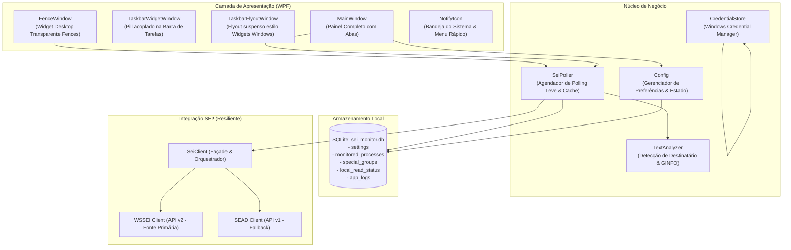

# Implementation Plan: SEI Desktop Monitor com Widget Fences e Rastreamento de Caixa Compartilhada

**Branch**: `001-sei-desktop-monitor` | **Date**: 2026-10-29 | **Status**: Planned

---

## 1. Technical Context & Stack

- **Linguagem & Runtime:** C# 14 / .NET 10 (`net10.0-windows`).
- **Framework de Interface:** WPF (Windows Presentation Foundation) para UI rica em aceleração de hardware.
- **Bandeja do Sistema:** Windows Forms (`UseWindowsForms=true`) exclusivamente para o componente nativo `System.Windows.Forms.NotifyIcon`.
- **Banco de Dados Local:** SQLite via `Microsoft.Data.Sqlite` (`10.0.*`), local em `%LOCALAPPDATA%\SEI Monitor\data\sei_monitor.db`.
- **Comunicação HTTP:** `System.Net.Http.HttpClient` com `SocketsHttpHandler` reutilizado, injeção de cabeçalhos dinâmicos e controle de expiração de token.
- **Segurança de Senhas:** Windows Credential Manager (`Advapi32.dll` via P/Invoke) sob o target `SEI Monitor`.

---

## 2. Diagrama de Arquitetura de Componentes



---

## 3. Esquema do Banco de Dados SQLite (`Core/Database.cs`)

```sql
-- Configurações gerais e preferências do usuário
CREATE TABLE IF NOT EXISTS settings (
    key TEXT PRIMARY KEY,
    value TEXT NOT NULL
);

-- Grupos de Acompanhamento Especial
CREATE TABLE IF NOT EXISTS special_groups (
    id TEXT PRIMARY KEY,
    nome TEXT NOT NULL,
    total_processos INTEGER DEFAULT 0,
    updated_at TEXT NOT NULL
);

-- Processos monitorados (Caixa de Entrada e Acompanhamento Especial)
CREATE TABLE IF NOT EXISTS monitored_processes (
    id TEXT PRIMARY KEY,                     -- idProcedimento do SEI
    protocolo_formatado TEXT NOT NULL,       -- Número do processo (ex.: 00001.000000/2026-00)
    descricao TEXT,
    tipo_processo TEXT,
    origem TEXT NOT NULL,                    -- 'CAIXA_ENTRADA', 'ACOMPANHAMENTO', ou 'AMBOS'
    id_grupo_especial TEXT,                  -- ID do grupo no acompanhamento (se houver)
    total_documentos INTEGER DEFAULT 0,      -- Total de docs no último check
    ultima_atividade_data TEXT,              -- Timestamp do último andamento
    ultima_atividade_desc TEXT,              -- Descrição do último andamento
    ultimo_usuario_nome TEXT,                -- Quem realizou a última ação
    aberto_por_terceiro INTEGER DEFAULT 0,   -- 1 se aberto por colega na unidade sem conclusão
    destinado_ao_usuario INTEGER DEFAULT 0,  -- 1 se contém nome/termo do usuário no despacho
    updated_at TEXT NOT NULL
);

-- Estado de leitura pessoal individual (independente do SEI web)
CREATE TABLE IF NOT EXISTS local_read_status (
    processo_id TEXT PRIMARY KEY,
    is_read_locally INTEGER DEFAULT 0,       -- 0 = Não Lido pelo usuário local; 1 = Lido
    last_read_doc_count INTEGER DEFAULT 0,
    last_read_at TEXT
);

-- Logs da aplicação sanitizados (sem URLs ou senhas do Solr)
CREATE TABLE IF NOT EXISTS app_logs (
    id INTEGER PRIMARY KEY AUTOINCREMENT,
    level TEXT NOT NULL,
    message TEXT NOT NULL,
    created_at TEXT NOT NULL
);
```

---

## 4. Pipeline de Integração SEI & Algoritmo de Polling Leve

### 4.1. Autenticação e Sanitização
1. O login no WSSEI é efetuado via `POST {SEI_WSSEI_BASE_URL}/autenticar` com `usuario`, `senha`, `orgao`.
2. Em caso de resposta de erro:
   - Se o mod-wssei retornar HTTP 200 com `sucesso: false`, os campos `mensagem` e `exception` contêm dados sensíveis do Solr.
   - O `SeiClient` captura o erro e emite exclusivamente `SeiException("SEI_ACESSO_NEGADO")` ou `SeiException("SEI_INDISPONIVEL")`, descartando o payload bruto.
3. Se o WSSEI estiver inacessível, chaveia automaticamente para a API da SEAD.

### 4.2. Algoritmo do Poller Leve (`SeiPoller.cs`)
```
Para cada ciclo de sincronização (ex.: 5 minutos):
1. Buscar lista de IDs da Caixa de Entrada da Unidade:
   GET processo/pesquisar ou lista de abertos na unidade ativa.
2. Buscar lista de IDs dos processos em Acompanhamento Especial da unidade:
   GET acompanhamento/listar ou endpoint equivalente.
3. Para cada processo na lista combinada:
   a. Chamar GET documento/listar/{id}?start=0&limit=1 -> obter total_docs
   b. Chamar GET atividade/listar?procedimento={id}&start=0&limit=1 -> obter data, hora, descricao, usuario
   c. Comparar com monitored_processes do SQLite:
      - Se (total_docs == db.total_docs E data_hora == db.ultima_atividade_data):
        -> Sem alteração. Não chamar mais nada para este processo!
      - Caso contrário:
        -> Detectou alteração!
        -> Atualizar banco.
        -> Marcar is_read_locally = 0.
        -> Executar TextAnalyzer(processo, ultimo_usuario, descricao_despacho).
4. Disparar evento SyncCompleted para atualizar o Widget e Painel via Dispatcher.
```

### 4.3. Algoritmo do `TextAnalyzer.cs` (Caixa Compartilhada GINFO)
```
1. Verificar quem fez a última ação:
   - Se usuario_acao != config.MeuUsuarioSEI:
     - Se o andamento for "Processo aberto na unidade", "Recebido na unidade", ou similar sem despacho resolutivo:
       processo.AbertoPorTerceiro = true;
2. Verificar destinatário do processo:
   - Extrair palavras-chave do usuário (config.Keywords, ex: "Victor", "vlima", "GINFO/Sistemas").
   - Verificar se alguma palavra-chave aparece em:
     a. Título / Descrição do processo;
     b. Texto do último documento/despacho (se houver novo documento gerado na unidade).
   - Se houver match:
     processo.DestinadoAoUsuario = true;
```

---

## 5. Implementação do Widget Desktop Fences (`Ui/FenceWindow.xaml.cs`)

- **Ancoragem Win32:**
  - `WindowInteropHelper(this).Handle` no evento `SourceInitialized`.
  - `SetWindowLongPtr(_hwnd, GWL_EXSTYLE, (ex | WS_EX_TOOLWINDOW | WS_EX_NOACTIVATE) & ~WS_EX_APPWINDOW)`.
  - `SetWindowLongPtr(_hwnd, GWLP_HWNDPARENT, progman)`.
  - `SetWindowPos(_hwnd, HWND_BOTTOM, 0, 0, 0, 0, SWP_NOMOVE | SWP_NOSIZE | SWP_NOACTIVATE)`.
- **Mecanismos de Resiliência:**
  - `DispatcherTimer` de 1 segundo checando se o Owner ainda é `Progman`. Se o Explorer reiniciar, reancora instantaneamente.
  - Evento `Deactivated` reenvia para `HWND_BOTTOM`.
  - Nunca chamar `WindowState = Normal` após minimizar, garantindo o funcionamento do `Win + D`.

### 5.2. Widget da Taskbar com Letreiro Deslizante & Painel Flyout Suspenso (`Ui/TaskbarWidgetWindow.xaml.cs` e `Ui/TaskbarFlyoutWindow.xaml.cs`)

- **Ancoragem na Barra de Tarefas e Ticker em Scrolling Horizontal:**
  - Janela compacta sem borda (`WindowStyle="None"`, `AllowsTransparency="True"`) que se posiciona sobre a barra de tarefas (`Shell_TrayWnd`), imediatamente à esquerda da área de notificação (`TrayNotifyWnd`).
  - Monitora mensagens de alteração de resolução e dimensões da taskbar (`ABM_GETTASKBARPOS` via `SHAppBarMessage`).
  - **Letreiro Digital em Scrolling Horizontal (Marquee Ticker):**
    - Componente WPF com animação suave (`DoubleAnimation` ou `Canvas` de rolagem contínua).
    - Alimentado pelo push do poller/aplicativo: exibe as últimas notificações em rotação deslizante (ex.: *"⚡ Novo processo recebido — 00001.000000/2026-00"*, *"📄 Novo documento juntado..."*, *"🎯 Processo destinado a você: ..."*).
    - Ao passar o mouse (`MouseEnter`), a rolagem pausa suavemente.
- **Painel Flyout Estilo Notícias e Clima (Flyout Dashboard):**
  - Ao clicar no widget da taskbar, abre `TaskbarFlyoutWindow` ancorada logo acima da barra de tarefas (alinhada à direita ou ao widget).
  - Dimensão aproximada de 380x520px com fundo escuro Fluent, cantos arredondados e sombra suave.
  - Seções em cards:
    1. **Cabeçalho:** Saudação personalizada ("Boa noite, Sergio — GINFO") + botão de sincronizar `🔄`.
    2. **Card "Destinado a Você" (🎯):** Processos prioritários com botão de abrir no navegador.
    3. **Card "Caixa GINFO" (⚡):** Últimos processos movimentados no setor com indicação de quem abriu.
    4. **Card "Acompanhamento Especial" (📂):** Acesso rápido aos processos monitorados por grupo.
    5. **Rodapé:** Botão para abrir o painel completo do SEI Monitor.
  - **Comportamento Autônomo:** Fecha suavemente no evento `Deactivated` (ao clicar fora).

---

## 6. Estrutura do Projeto

```
z:/sei-monitor/
├── src/
│   └── SeiMonitor/
│       ├── SeiMonitor.csproj
│       ├── app.manifest
│       ├── App.xaml / App.xaml.cs
│       ├── Core/
│       │   ├── Database.cs
│       │   ├── Config.cs
│       │   ├── CredentialStore.cs
│       │   ├── SeiClient.cs
│       │   ├── SeiPoller.cs
│       │   ├── TextAnalyzer.cs
│       │   └── Models/
│       │       ├── ProcessoItem.cs
│       │       ├── AndamentoItem.cs
│       │       └── GrupoAcompanhamento.cs
│       └── Ui/
│           ├── Theme.cs
│           ├── FenceWindow.xaml / FenceWindow.xaml.cs
│           ├── MainWindow.xaml / MainWindow.xaml.cs
│           └── DetailWindow.xaml / DetailWindow.xaml.cs
```
